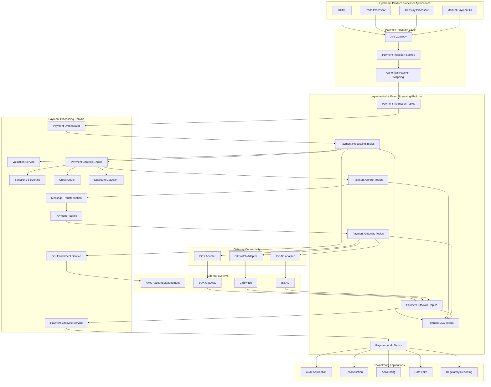
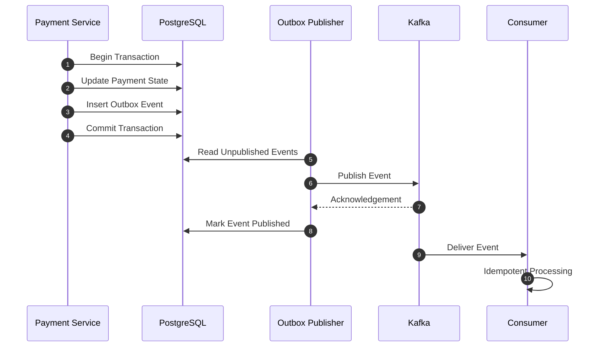
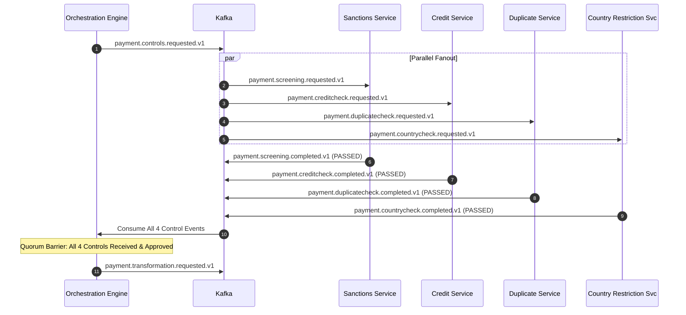
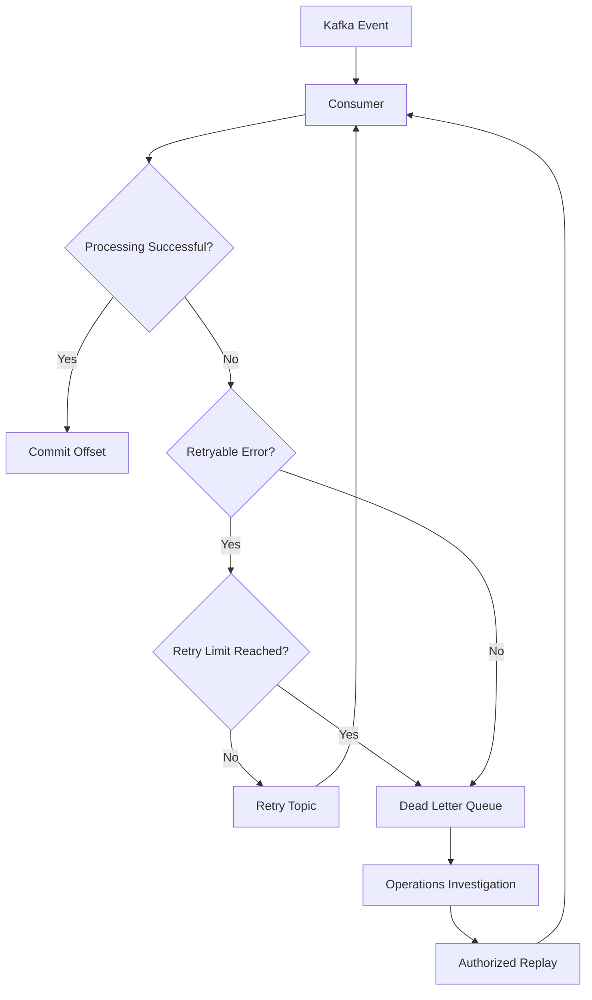
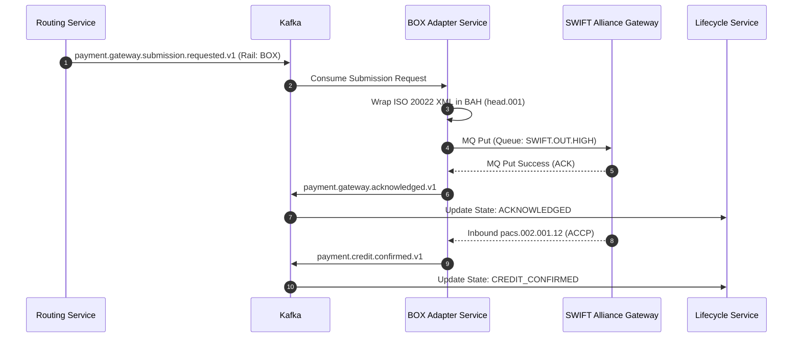
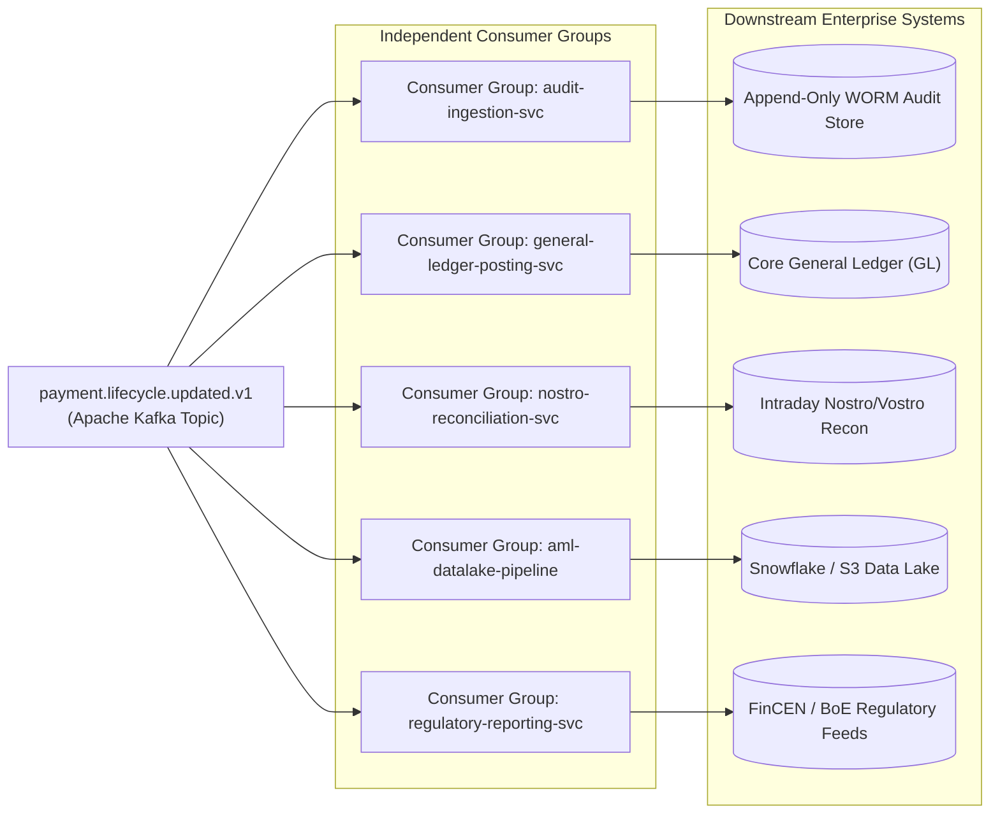
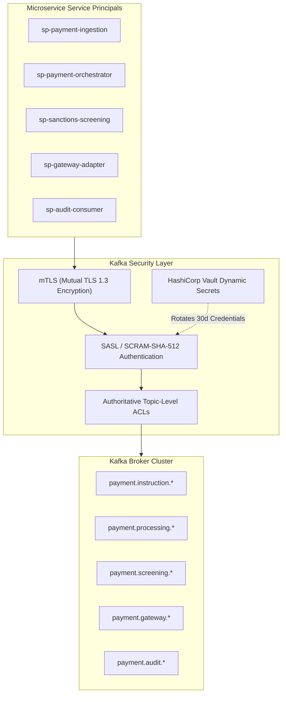
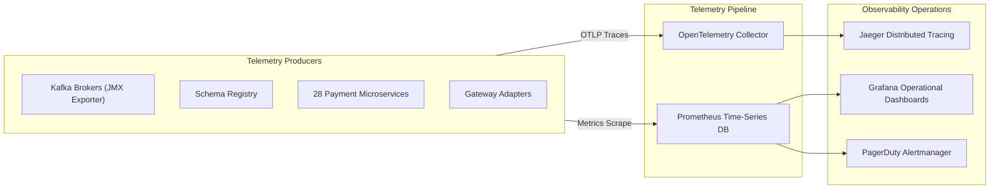

# Global Payment Hub (GPH) — Kafka-Based Event-Driven Payment Processor Architecture
## Master Architecture Specification & Technical Reference (EDA / DDD / Saga)

**Document Version:** 4.0.0  
**Classification:** Tier-0 Mission-Critical Financial Systems Specification  
**Architecture Paradigm:** Event-Driven Architecture (EDA) & Distributed Sagas over Apache Kafka  
**Scale Target:** 10,000,000 Daily Active Users (DAU) | 50,000,000 Transactions/Day | 12,000 Peak TPS  
**Standards Compliance:** CloudEvents v1.0, ISO 20022 (CBPR+ / HVPS+), Apache Kafka 3.6+ (KRaft), Avro / Protobuf Schema Registry, BCBS 239  

---

## 1. Architecture Mandate

The Global Payment Hub (GPH) is fundamentally re-architected from the ground up as an **Event-Driven, Kafka-based distributed platform**. Synchronous REST chaining between internal payment processing microservices is strictly prohibited as a default pattern. Apache Kafka functions as the authoritative, persistent, and horizontally scalable event streaming nervous system.

### 1.1 Core Architectural Tenets
1. **Event-Driven Architecture (EDA):** All state changes, business decisions, control validations, format transformations, and gateway submissions are emitted as immutable domain events.
2. **Domain-Driven Design (DDD):** Clean strategic bounded contexts with well-defined ubiquitous language, aggregates, and decoupled database-per-service boundaries.
3. **Microservices Architecture:** Independently deployable, stateless containerized services communicating over Kafka event topics and gRPC (strictly for non-blocking stream transport).
4. **Asynchronous Communication & Eventual Consistency:** Non-blocking event emission with transactional boundaries isolated to individual services. Global consistency is achieved via eventual convergence.
5. **Database-per-Service:** No shared database instances between distinct microservices. Each microservice manages its own localized schema and transactional datastore.
6. **Transactional Outbox Pattern:** Guarantees atomic database state mutation and event generation within a single local database transaction before offset acknowledgement.
7. **Transactional Inbox & Idempotent Consumers:** Every event consumer enforces idempotency via deduplication repositories and unique database constraints.
8. **Saga Pattern for Distributed Processing:** Stateful orchestration coordinates distributed Saga transactions with forward execution and backward compensating transactions.
9. **Schema Registry & Event Versioning:** Strict contract enforcement with backward/forward schema compatibility rules.
10. **Configurable Pipeline Execution:** Runtime pipeline topologies and control rulebooks are versioned and dynamically resolved per payment instruction.

### 1.2 Inter-Service Communication Principles

| Interaction Boundary | Permitted Protocol | Implementation Details |
| :--- | :--- | :--- |
| **Product Processor → Payment Ingestion** | **REST / Kafka** | Synchronous REST for instant receipt acknowledgment; Kafka for high-throughput batch streams. |
| **Payment Microservice → Payment Microservice** | **Kafka Events** | Asynchronous events over partitioned topics; zero synchronous REST coupling. |
| **Payment Orchestrator → Processing Services** | **Kafka Commands / Events** | Command topics dispatched by Orchestrator; result events consumed asynchronously. |
| **Payment Controls → Payment Processing** | **Kafka** | Parallel control execution (Sanctions, Credit, Duplicate, Country) via command/event topics. |
| **AMC SSI Integration** | **Kafka Request/Reply** | Kafka request/reply with correlated correlation IDs; REST adapter for legacy AMC fallback. |
| **BOX Gateway Adapter** | **Kafka + Netty Adapter** | Subscribed to gateway submission topic; communicates with SWIFT SAG over IBM MQ / TCP. |
| **CitiSwitch Gateway Adapter** | **Kafka + REST Adapter** | Subscribed to gateway submission topic; dispatches mTLS HTTPS REST requests to CitiSwitch. |
| **ISSAC Domestic Gateway Adapter** | **Kafka + REST Adapter** | Subscribed to gateway submission topic; dispatches synchronous REST JSON to National Switch. |
| **Gateway ACK / NACK** | **Kafka** | Normalized gateway acknowledgements published directly to lifecycle topics. |
| **Credit Confirmation (pacs.002 ACCP)** | **Kafka** | Inbound clearing status reports published to credit confirmation topic. |
| **Downstream Audit Applications** | **Kafka** | Immutable audit events consumed independently from dedicated audit topics. |
| **Downstream Reconciliation** | **Kafka** | Continuous transaction matching consumed independently from reconciliation topics. |
| **Payment & Operations UI → Backend** | **REST APIs / SSE** | Synchronous read/write query APIs with Server-Sent Events (SSE) for live push updates. |
| **Pipeline Configuration UI → Backend** | **REST APIs** | Operational Maker-Checker administration APIs emitting Kafka configuration change events. |
| **Maker-Checker Workflow** | **Kafka-Driven Workflow** | Independent dual-blind voting events coordinated over Kafka approval topics. |
| **Reporting & Management Information (MI)** | **Kafka + OLAP Store** | Streaming Kafka connect sink into ClickHouse / Snowflake reporting data stores. |

---

## 2. Kafka-Based High-Level Architecture

The end-to-end architecture decouples Ingress, Core Orchestration, Payment Controls, Format Transformation, Multi-Rail Gateway Connectivity, and Downstream Subscribers using Apache Kafka as the central event distribution backbone.



---

## 3. Payment Processing Event Flow

The sequence diagram below represents the logical progression of events and commands across the Kafka event streaming platform. All communications are non-blocking and persisted at every hop.

```mermaid
sequenceDiagram
    autonumber
    participant GCMS as GCMS
    participant ING as Payment Ingestion
    participant K as Kafka
    participant ORC as Payment Orchestrator
    participant VAL as Validation
    participant SSI as SSI Enrichment
    participant CTRL as Controls Engine
    participant TRF as Transformation
    participant RTE as Routing
    participant GW as Gateway Adapter
    participant BOX as BOX Gateway
    participant LCM as Payment Lifecycle
    participant AUD as Audit Application
    GCMS->>ING: Submit Payment Instruction
    ING->>ING: Authenticate and Validate Source
    ING->>ING: Generate Payment ID
    ING->>K: PaymentInstructionReceived
    K->>ORC: Consume PaymentInstructionReceived
    ORC->>K: PaymentValidationRequested
    K->>VAL: Consume Validation Request
    VAL->>VAL: Validate Payment
    VAL->>K: PaymentValidationCompleted
    K->>ORC: Validation Result
    ORC->>K: PaymentEnrichmentRequested
    K->>SSI: Consume Enrichment Request
    SSI->>SSI: Retrieve SSI from AMC
    SSI->>K: PaymentEnrichmentCompleted
    K->>ORC: Enrichment Result
    ORC->>K: PaymentControlsRequested
    K->>CTRL: Execute Payment Controls
    CTRL->>K: PaymentControlsCompleted
    K->>ORC: Control Result
    ORC->>K: PaymentTransformationRequested
    K->>TRF: Transform Payment
    TRF->>K: PaymentTransformationCompleted
    K->>ORC: Transformation Result
    ORC->>K: PaymentRoutingRequested
    K->>RTE: Determine Gateway
    RTE->>K: PaymentRouteDetermined
    K->>GW: PaymentSubmissionRequested
    GW->>BOX: Submit pacs.008
    BOX-->>GW: Gateway ACK
    GW->>K: PaymentAcknowledged
    BOX-->>GW: Credit Confirmation
    GW->>K: PaymentCreditConfirmed
    K->>LCM: Update Payment Lifecycle
    LCM->>K: PaymentLifecycleUpdated
    K->>AUD: Payment Lifecycle Events
```

---

## 4. Kafka Topic Design & Catalog

All Kafka topics follow strict hierarchical naming conventions:

$$\text{Topic Name} = \langle\text{domain}\rangle.\langle\text{capability}\rangle.\langle\text{event-or-command}\rangle.\langle\text{version}\rangle$$

### 4.1 Payment Processing & Operational Topics Catalog

| Topic Name | Purpose | Producer | Consumer | Partition Key | Schema | Partitions | RF | Retention | Ordering Scope | DLQ Topic |
| :--- | :--- | :--- | :--- | :--- | :--- | :--- | :--- | :--- | :--- | :--- |
| `payment.instruction.received.v1` | Ingests new payment from intake edge | Ingestion Service | Orchestrator Service | `paymentId` | Avro / Protobuf | 64 | 3 | 7 Days | Per-Account | `payment.instruction.dlq.v1` |
| `payment.validation.requested.v1` | Command to execute syntax/schema checks | Orchestrator | Validation Service | `paymentId` | Avro / Protobuf | 64 | 3 | 3 Days | Per-Account | `payment.validation.dlq.v1` |
| `payment.validation.completed.v1` | Emits syntax validation pass/fail | Validation Service | Orchestrator | `paymentId` | Avro / Protobuf | 64 | 3 | 7 Days | Per-Account | `payment.validation.dlq.v1` |
| `payment.enrichment.requested.v1` | Command to lookup Nostro/Vostro SSI | Orchestrator | SSI Service | `paymentId` | Avro / Protobuf | 64 | 3 | 3 Days | Per-Account | `payment.enrichment.dlq.v1` |
| `payment.enrichment.completed.v1` | Emits enriched routing & counterparty SSI| SSI Service | Orchestrator | `paymentId` | Avro / Protobuf | 64 | 3 | 7 Days | Per-Account | `payment.enrichment.dlq.v1` |
| `payment.controls.requested.v1` | Command to initiate risk controls suite | Orchestrator | Controls Engine | `paymentId` | Avro / Protobuf | 64 | 3 | 3 Days | Per-Account | `payment.controls.dlq.v1` |
| `payment.controls.completed.v1` | Aggregated result of pre-execution controls| Controls Engine | Orchestrator | `paymentId` | Avro / Protobuf | 64 | 3 | 7 Days | Per-Account | `payment.controls.dlq.v1` |
| `payment.screening.requested.v1` | Sub-command: Sanctions fuzzy screening | Controls Engine | Sanctions Service | `paymentId` | Avro / Protobuf | 64 | 3 | 3 Days | Per-Account | `payment.controls.dlq.v1` |
| `payment.screening.completed.v1` | Result of OFAC/EU/UN sanctions match | Sanctions Service | Controls Engine | `paymentId` | Avro / Protobuf | 64 | 3 | 7 Days | Per-Account | `payment.controls.dlq.v1` |
| `payment.creditcheck.requested.v1`| Sub-command: Intraday credit limits | Controls Engine | Credit Service | `debtorId` | Avro / Protobuf | 64 | 3 | 3 Days | Per-Debtor | `payment.controls.dlq.v1` |
| `payment.creditcheck.completed.v1`| Result of debtor credit limit balance | Credit Service | Controls Engine | `debtorId` | Avro / Protobuf | 64 | 3 | 7 Days | Per-Debtor | `payment.controls.dlq.v1` |
| `payment.duplicatecheck.requested.v1`| Sub-command: Sliding window hash check | Controls Engine | Duplicate Service | `hashKey` | Avro / Protobuf | 64 | 3 | 3 Days | Per-Hash | `payment.controls.dlq.v1` |
| `payment.duplicatecheck.completed.v1`| Result of 60-min duplicate verification | Duplicate Service | Controls Engine | `hashKey` | Avro / Protobuf | 64 | 3 | 7 Days | Per-Hash | `payment.controls.dlq.v1` |
| `payment.approval.requested.v1` | Triggers single or dual-blind 4-eyes review| Orchestrator | Maker-Checker Svc | `paymentId` | Avro / Protobuf | 32 | 3 | 14 Days | Per-Account | `payment.approval.dlq.v1` |
| `payment.approval.completed.v1` | Quorum decision reached by Checkers | Maker-Checker Svc | Orchestrator | `paymentId` | Avro / Protobuf | 32 | 3 | 14 Days | Per-Account | `payment.approval.dlq.v1` |
| `payment.transformation.requested.v1`| Command to generate ISO 20022 XML/JSON| Orchestrator | Transform Service | `paymentId` | Avro / Protobuf | 64 | 3 | 3 Days | Per-Account | `payment.transform.dlq.v1` |
| `payment.transformation.completed.v1`| Emits compiled market message payload | Transform Service | Orchestrator | `paymentId` | Avro / Protobuf | 64 | 3 | 7 Days | Per-Account | `payment.transform.dlq.v1` |
| `payment.routing.requested.v1` | Command to evaluate clearing rails/cut-offs| Orchestrator | Routing Service | `paymentId` | Avro / Protobuf | 64 | 3 | 3 Days | Per-Account | `payment.routing.dlq.v1` |
| `payment.routing.completed.v1` | Optimal gateway rail and circuit determined| Routing Service | Orchestrator | `paymentId` | Avro / Protobuf | 64 | 3 | 7 Days | Per-Account | `payment.routing.dlq.v1` |
| `payment.gateway.submission.requested.v1`| Command to dispatch payload to gateway | Orchestrator | Gateway Adapters | `gatewayId` | Avro / Protobuf | 64 | 3 | 7 Days | Per-Gateway | `payment.gateway.dlq.v1` |
| `payment.gateway.acknowledged.v1` | Technical network ACK received (e.g. MT019)| Gateway Adapters | Lifecycle Service | `paymentId` | Avro / Protobuf | 64 | 3 | 14 Days | Per-Account | `payment.gateway.dlq.v1` |
| `payment.gateway.rejected.v1` | Technical network NACK or clearing reject | Gateway Adapters | Lifecycle Service | `paymentId` | Avro / Protobuf | 64 | 3 | 14 Days | Per-Account | `payment.gateway.dlq.v1` |
| `payment.settlement.confirmed.v1` | Irrevocable settlement across Nostro/Vostro| Gateway Adapters | Lifecycle Service | `paymentId` | Avro / Protobuf | 64 | 3 | 30 Days | Per-Account | `payment.gateway.dlq.v1` |
| `payment.credit.confirmed.v1` | Explicit beneficiary credit (pacs.002 ACCP)| Gateway Adapters | Lifecycle Service | `paymentId` | Avro / Protobuf | 64 | 3 | 30 Days | Per-Account | `payment.gateway.dlq.v1` |
| `payment.lifecycle.updated.v1` | Authoritative state transition event | Lifecycle Service | Downstream Bus | `paymentId` | Avro / Protobuf | 64 | 3 | 90 Days | Per-Account | `payment.lifecycle.dlq.v1` |
| `payment.repair.requested.v1` | Defective payment sent to repair desk | Lifecycle Service | Repair Service | `paymentId` | Avro / Protobuf | 16 | 3 | 30 Days | Per-Account | `payment.repair.dlq.v1` |
| `payment.repair.completed.v1` | Corrected fields resubmitted for processing | Repair Service | Orchestrator | `paymentId` | Avro / Protobuf | 16 | 3 | 30 Days | Per-Account | `payment.repair.dlq.v1` |
| `payment.returned.v1` | Clearing return received (pacs.004) | Gateway Adapters | Lifecycle Service | `paymentId` | Avro / Protobuf | 32 | 3 | 90 Days | Per-Account | `payment.gateway.dlq.v1` |
| `payment.cancelled.v1` | Payment recall/cancellation (camt.056) | Gateway Adapters | Lifecycle Service | `paymentId` | Avro / Protobuf | 32 | 3 | 90 Days | Per-Account | `payment.gateway.dlq.v1` |
| `payment.audit.events.v1` | Immutable, tamper-evident audit record | Audit Service | Audit Store / WORM | `uetr` | Avro / Protobuf | 64 | 3 | 2555 Days (7 Yr)| Per-UETR | `payment.audit.dlq.v1` |
| `payment.downstream.delivery.v1` | Enriched event for GL, Recon, Data Lake | Downstream Egress | GL, Recon, Data Lake| `paymentId` | Avro / Protobuf | 64 | 3 | 90 Days | Per-Account | `payment.downstream.dlq.v1` |

### 4.2 Configuration Management Topics

| Topic Name | Purpose | Producer | Consumer | Partition Key | Schema | Partitions | RF | Retention |
| :--- | :--- | :--- | :--- | :--- | :--- | :--- | :--- | :--- |
| `payment.pipeline.configuration.changed.v1` | Draft pipeline config modified | Config UI Service | Approval Engine | `pipelineId` | JSON / Avro | 8 | 3 | 365 Days |
| `payment.pipeline.configuration.approved.v1`| Dual-blind approval of pipeline | Approval Engine | Config Registry | `pipelineId` | JSON / Avro | 8 | 3 | 365 Days |
| `payment.pipeline.activated.v1` | Production activation of versioned pipeline| Config Registry | Orchestrator Cache | `pipelineId` | JSON / Avro | 8 | 3 | 365 Days |
| `payment.controls.configuration.changed.v1` | Control thresholds edited (e.g. $2M) | Controls Admin | Approval Engine | `controlId` | JSON / Avro | 8 | 3 | 365 Days |
| `payment.controls.configuration.approved.v1`| Control threshold changes approved | Approval Engine | Controls Engine | `controlId` | JSON / Avro | 8 | 3 | 365 Days |
| `payment.gateway.configuration.changed.v1` | Gateway endpoint or cut-off modified | Gateway Admin | Approval Engine | `gatewayId` | JSON / Avro | 8 | 3 | 365 Days |
| `payment.gateway.configuration.approved.v1`| Gateway configuration approved | Approval Engine | Gateway Router | `gatewayId` | JSON / Avro | 8 | 3 | 365 Days |
| `payment.mapping.configuration.changed.v1` | Field mapping rulebook modified | Mapping Admin | Approval Engine | `mappingId` | JSON / Avro | 8 | 3 | 365 Days |
| `payment.mapping.configuration.approved.v1`| Field mapping rulebook approved | Approval Engine | Transform Engine | `mappingId` | JSON / Avro | 8 | 3 | 365 Days |

---

## 5. Kafka Event Contract (CloudEvents 1.0 Specification)

All payment events emitted across Kafka must strictly conform to the **CloudEvents v1.0 standard envelope**. Exact decimal representation (e.g. string representation or micro-units `int64`) is mandatory to eliminate floating-point representation drift.

### 5.1 Standard Event Envelope Schema (JSON / Avro)

```json
{
  "specversion": "1.0",
  "id": "EVT-20261106-4F96C211",
  "type": "com.bank.payment.validation.completed.v1",
  "source": "payment-validation-service",
  "subject": "PAY-20261106-000001",
  "time": "2026-11-06T10:15:30.124Z",
  "datacontenttype": "application/json",
  "dataschema": "https://schema-registry.bank.internal/schemas/payment.validation.completed.v1.avsc",
  "correlationid": "CORR-9988224411AA",
  "causationid": "EVT-20261106-INSTRUCTION-0001",
  "traceparent": "00-4bf92f3577b34da6a3ce929d0e0e4736-00f067aa0ba902b7-01",
  "pipelineid": "GCMS-SWIFT-PACS008",
  "pipelineversion": 3,
  "data": {
    "paymentId": "PAY-20261106-000001",
    "uetr": "4f96c211-12a8-42f1-bb21-9988224411aa",
    "sourceSystem": "GCMS",
    "paymentType": "SWIFT_PACS_008",
    "amount": "450000.00",
    "currency": "USD",
    "valueDate": "2026-11-06",
    "validationStatus": "PASSED",
    "checksExecuted": [
      { "check": "MANDATORY_FIELDS", "result": "VALID" },
      { "check": "ISO_4217_CURRENCY", "result": "VALID" },
      { "check": "IBAN_SYNTAX", "result": "VALID" },
      { "check": "BIC_STRUCTURE", "result": "VALID" }
    ],
    "validatedAt": "2026-11-06T10:15:30.120Z"
  }
}
```

### 5.2 Schema Registry & Compatibility Evolution Rules
- **Registry Engine**: Confluent Schema Registry / Apicurio running multi-node in KRaft mode.
- **Compatibility Level**: **BACKWARD_TRANSITIVE** (guarantees that older consumers can always process messages generated by newer producers).
- **Field Addition Rules**: New fields must define a `default` value or be declared as optional unions (`["null", "string"]`).
- **Field Removal Rules**: Active fields cannot be deleted; deprecated fields must remain with default values for at least two major release cycles.
- **Breaking Changes Policy**: Breaking modifications require incrementing the event version in the topic name (e.g. `.v1` $\rightarrow$ `.v2`) and running parallel consumer streams until deprecation.

---

## 6. Kafka Processing Guarantees & Transactional Integrity

### 6.1 Idempotent Consumer Pattern
Every Kafka consumer service must guarantee that processing an event multiple times produces the exact same state as processing it once.

```
Kafka Message ──> [ Consumer Interceptor ]
                         │
                  Check Event ID in
             Processed Event Repository
                         │
             ┌───────────┴───────────┐
      [ Exists: SKIP ]       [ New: BEGIN TX ]
             │                       │
      Commit Offset          Update State + Record Event ID
                                     │
                             COMMIT Local TX ──> Commit Offset
```

### 6.2 Transactional Outbox Pattern
Services updating localized business data and emitting Kafka events use the Transactional Outbox pattern to prevent two-phase commit (2PC) bottlenecks:



### 6.3 Transactional Inbox Pattern
For critical services (e.g. Orchestrator, Gateway Dispatcher, Accounting Ledger), inbound messages are recorded into an **Inbox Table** in the service's database within the same transaction that updates business state:

1. Inbound Kafka event received by worker thread.
2. Validate `id` (Event UUID) and `idempotency_key`.
3. Query `inbox_events` table for existence of `id`.
4. If record exists: acknowledge Kafka offset immediately and discard duplicate execution.
5. If record does not exist:
   - Begin local PostgreSQL ACID transaction.
   - Insert event into `inbox_events` table.
   - Execute domain business logic and update state.
   - Insert outgoing events into `outbox_events` table.
   - Commit PostgreSQL transaction.
6. Acknowledge Kafka message offset.

### 6.4 Effective End-to-End Delivery Guarantees Matrix

| Integration Boundary | Delivery Guarantee | Mechanism Enforcing Guarantee |
| :--- | :--- | :--- |
| **Kafka Broker Internals** | At-Least-Once (`acks=all`) | `min.insync.replicas=2`, `replication.factor=3`, `enable.idempotence=true`. |
| **Database to Kafka** | Exactly-Once Atomic | Transactional Outbox pattern via PostgreSQL logical WAL decoding (Debezium CDC). |
| **Kafka to Database** | Effectively Exactly-Once | Transactional Inbox pattern with primary key uniqueness constraints on `event_id`. |
| **GPH to SWIFT BOX Gateway** | Effectively Exactly-Once | SWIFT Session Number + Sequence Number + UETR deduplication at Alliance Gateway. |
| **GPH to CitiSwitch Gateway** | Effectively Exactly-Once | HTTP Idempotency-Key header (`X-Idempotency-Key: {uetr}`) + server-side deduplication. |
| **GPH to ISSAC Domestic Switch** | Effectively Exactly-Once | National Settlement Transaction ID composite deduplication. |

---

## 7. Kafka-Based Payment Orchestration & Parallel Controls

The Payment Orchestration Engine is a **stateful, non-blocking Saga coordinator**. It evaluates incoming events, resolves the active pipeline version, and commands downstream worker services.

### 7.1 Parallel Control Execution Pattern
Unlike synchronous architectures that evaluate controls sequentially, GPH evaluates independent risk controls **concurrently** over Kafka:



### 7.2 Orchestration State Machine Invariants
- In-memory state is treated as transient cache; the **authoritative Saga state** is persisted in PostgreSQL.
- If the Orchestrator service crashes or is restarted, upon recovery it rebuilds its state from the persistent database and resumes listening from the last committed Kafka offset.
- Quorum Barrier: A payment cannot proceed to transformation until all configured controls emit completed events with status `PASSED` or `APPROVED`.

---

## 8. Kafka Retry & Dead Letter Queue (DLQ) Architecture

To prevent a single malformed message ("poison pill") from halting processing across a Kafka partition, GPH implements a non-blocking multi-tier retry topic topology.



### 8.1 Error Classification & Handling Taxonomy

| Error Category | Examples | Retry Strategy | Backoff Policy | Destination on Exhaustion |
| :--- | :--- | :--- | :--- | :--- |
| **Transient Technical** | DB connection pool timeout, transient Kafka network glitch | Non-blocking Retry Topic | Exponential: 1s, 2s, 4s, 8s (Max 4 attempts) | DLQ Topic (`.dlq.v1`) |
| **Gateway Network Timeout** | SWIFT SAG connection dropped, CitiSwitch socket reset | Gateway Retry Topic | 5s, 15s, 45s (Max 3 attempts) | Trigger Automated Failover |
| **Schema Validation Failure** | Missing mandatory field, invalid ISO-4217 currency | Non-retryable (Immediate) | No retry | Payment Repair Desk |
| **Sanctions Match (OFAC)** | Score $\ge 80\%$ on SDN list | **Business State (NOT technical error)**| Do NOT route to DLQ | Set State: `ON_HOLD` |
| **Credit Limit Exceeded** | Debtor intraday liquidity line breached | **Business State (NOT technical error)**| Do NOT route to DLQ | Set State: `ON_HOLD` |
| **Duplicate Detected** | 60-min hash matches prior payment | **Business State (NOT technical error)**| Do NOT route to DLQ | Set State: `SUPPRESSED` |
| **Approval Pending** | Payment $\ge \$2\text{M}$ mandates Dual-Blind | **Governance State** | Do NOT route to DLQ | Set State: `DUAL_BLIND_PENDING` |

---

## 9. Kafka Payment Gateway Integration & Failover

### 9.1 SWIFT BOX Submission Sequence


### 9.2 Gateway Timeout & Automated Circuit-Breaker Failover Sequence
```mermaid
sequenceDiagram
    autonumber
    participant ORC as Orchestrator Service
    participant K as Kafka
    participant BOX as SWIFT BOX Adapter
    participant CB as Circuit Breaker
    participant RTE as Dynamic Router
    participant CITI as CitiSwitch Adapter
    participant LCM as Lifecycle Service

    ORC->>K: payment.gateway.submission.requested.v1 (Rail: BOX)
    K->>BOX: Consume Submission Request
    Note over BOX: SWIFT SAG Connection Timeout (> 3,000ms)
    BOX->>CB: Record Failure (Consecutive Failures = 3)
    Note over CB: Circuit Breaker Trips: CLOSED -> OPEN
    BOX->>K: payment.gateway.rejected.v1 (Reason: TIMEOUT_CB_OPEN)
    K->>RTE: Consume Failure Event
    RTE->>RTE: Re-evaluate Matrix: Failover to Secondary Rail (CitiSwitch)
    RTE->>K: payment.routing.completed.v1 (Rail: CITISWITCH, Failover: true)
    K->>ORC: Route Updated
    ORC->>K: payment.gateway.submission.requested.v1 (Rail: CITISWITCH)
    K->>CITI: Consume Submission Request
    CITI->>CITI: Dispatch mTLS REST POST to CitiSwitch
    CITI->>K: payment.gateway.acknowledged.v1
    K->>LCM: Update State: ACKNOWLEDGED (via CitiSwitch Failover)
```

---

## 10. Kafka Configuration Management & Version Isolation

Pipeline topologies, market mapping tables, control thresholds, and gateway cut-offs are managed as **event-driven, immutable configurations**.

```mermaid
sequenceDiagram
    autonumber
    participant UI as Config Admin UI
    participant CFG as Config Service
    participant K as Kafka
    participant APP as Approval Workflow
    participant ORC as Orchestrator Cache
    participant DB as Config Database

    UI->>CFG: Submit Pipeline Change (v3 -> v4)
    CFG->>DB: Persist Draft Pipeline v4
    CFG->>K: payment.pipeline.configuration.changed.v1
    K->>APP: Route to Checker Review
    APP->>K: payment.pipeline.configuration.approved.v1
    K->>CFG: Consume Approved Event
    CFG->>DB: Set Status: ACTIVE (v4)
    CFG->>K: payment.pipeline.activated.v1
    K->>ORC: Invalidate L2 Config Cache
    Note over ORC: In-Flight Payments retain v3 Snapshot; New Payments bind to v4
```

### 10.1 In-Flight Version Isolation Guarantee
When a new pipeline version is activated:
- The exact `pipeline_id` and `pipeline_version` integer are stamped on the payment instruction at the moment of intake.
- Throughout all 18 processing steps, the Orchestrator binds exclusively to the configuration snapshot corresponding to `pipeline_version`.
- In-flight payments are strictly immune to concurrent configuration activations.

---

## 11. Kafka Downstream Audit, Reconciliation & Event Egress

External consumer applications consume normalized lifecycle events using **independent Kafka Consumer Groups**, ensuring full operational isolation:



---

## 12. Kafka Security Architecture & Access Control (ACLs)

Every microservice authenticates with Apache Kafka using its own dedicated service principal. Topic-level access is governed by least-privilege Access Control Lists (ACLs).



### 12.1 Kafka Topic Access Control Matrix (ACLs)

| Service Identity (Principal) | Permitted Topics (WRITE) | Permitted Topics (READ) | Operation Allowed |
| :--- | :--- | :--- | :--- |
| `User:sp-ingestion-svc` | `payment.instruction.received.v1` | None | Write Only |
| `User:sp-orchestrator-svc`| `payment.validation.requested.v1`, `payment.controls.requested.v1`, `payment.transformation.requested.v1`, `payment.routing.requested.v1`, `payment.gateway.submission.requested.v1` | `payment.instruction.received.v1`, `payment.*.completed.v1`, `payment.gateway.acknowledged.v1` | Read / Write |
| `User:sp-sanctions-svc` | `payment.screening.completed.v1` | `payment.screening.requested.v1` | Read / Write |
| `User:sp-credit-svc` | `payment.creditcheck.completed.v1` | `payment.creditcheck.requested.v1` | Read / Write |
| `User:sp-gateway-adapter` | `payment.gateway.acknowledged.v1`, `payment.gateway.rejected.v1`, `payment.credit.confirmed.v1` | `payment.gateway.submission.requested.v1` | Read / Write |
| `User:sp-audit-consumer` | None | `payment.audit.events.v1`, `payment.lifecycle.updated.v1` | Read Only |
| `User:sp-recon-consumer` | None | `payment.lifecycle.updated.v1`, `payment.settlement.confirmed.v1` | Read Only |

---

## 13. Kafka Observability & Telemetry Framework

GPH exports comprehensive Prometheus metrics, OpenTelemetry distributed trace spans, and structured JSON logs.



### 13.1 Production Metric Alerting Rules (Low Cardinality)
To prevent Prometheus TSDB cardinality explosions, metrics **never include high-cardinality IDs** (such as `payment_id` or `uetr`) as metric labels. Instead, labels are restricted to `[service, topic, partition, consumergroup, error_code]`.

- `kafka_consumergroup_lag > 5000` (Warning: Consumer processing lag accumulating).
- `rate(payment_dlq_events_total[5m]) > 10` (Critical: Poison pill or downstream outage).
- `rate(payment_gateway_circuit_breaker_tripped[1m]) > 0` (Critical: Gateway rail failover triggered).
- `payment_e2e_processing_latency_seconds{quantile="0.99"} > 0.150` (SLA Breach: P99 latency exceeding 150ms).

---

## 14. Architecture Validation & Gap Analysis

| Validation Criterion | Architectural Status | Implementation & Mitigation Mechanism |
| :--- | :--- | :--- |
| **Payment Ingestion Event-Driven?** | **VERIFIED** | Ingestion service authenticates payload, writes to outbox, and publishes `payment.instruction.received.v1`. |
| **Payment Orchestration Event-Driven?** | **VERIFIED** | Master FSM acts as asynchronous Saga coordinator consuming results and emitting command events. |
| **Payment Controls Event-Driven?** | **VERIFIED** | Sanctions, Credit, Duplicate, and Country checks execute in parallel over isolated topics. |
| **Transformation Event-Driven?** | **VERIFIED** | Message Transformation Service consumes CPM and compiles ISO 20022 XML asynchronously. |
| **Routing Event-Driven?** | **VERIFIED** | Payment Routing Service resolves clearing matrix and circuit breaker states over Kafka. |
| **Gateway Submission Event-Driven?** | **VERIFIED** | Pluggable Gateway Adapters consume submission commands and interface with external SAG/switches. |
| **Gateway ACK/NACK Event-Driven?** | **VERIFIED** | Technical gateway responses parsed into normalized events and published to lifecycle topics. |
| **Credit Confirmation Event-Driven?** | **VERIFIED** | Inbound clearing status reports (`pacs.002` ACCP) published to `payment.credit.confirmed.v1`. |
| **Lifecycle Updates Event-Driven?** | **VERIFIED** | Lifecycle Service maintains authoritative audit timeline and emits broadcast events. |
| **Downstream Audit & Recon Event-Driven?**| **VERIFIED** | Separate consumer groups independently consume events for GL, Recon, Data Lake, and Reg feeds. |
| **Configuration Event-Driven?** | **VERIFIED** | Versioned pipelines and control thresholds managed via approval events with in-flight isolation. |
| **Maker-Checker Workflow Event-Driven?** | **VERIFIED** | Dual-blind voting records published to approval topics; quorum verified without shared state. |
| **Payment Duplication Risk?** | **ELIMINATED** | Transactional Inbox pattern + composite idempotency key (`sourceSystem:sourceTxId:valueDate`). |
| **Partition Ordering Risk?** | **ELIMINATED** | 64 partitions keyed strictly by `debtor_account_number`, guaranteeing single-account sequence. |
| **Consumer Recovery on Crash?** | **VERIFIED** | Persistent PostgreSQL state machine resumes from committed Kafka offset upon container restart. |

---
